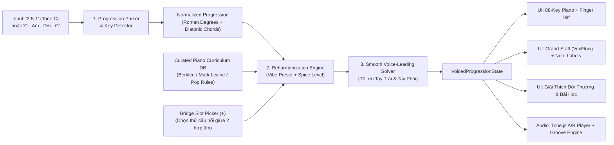

# Piano Harmony & Ear Training Coach — Master Architecture & Stage 1 Design Specification

**Date**: 2026-10-30  
**Author**: Antigravity Master Orchestrator (`agency-product-manager` & `agency-software-architect`)  
**Repository**: `https://github.com/vanhgonnasleep/Piano-Harmony-Coach`  
**Status**: Approved Architecture — Ready for Implementation Planning

---

## 1. Bối Cảnh & Mục Tiêu Sản Phẩm (Problem & Product Vision)

### 1.1. Chân dung người dùng (Target Persona)
Người yêu âm nhạc tự học đàn (không qua trường lớp nhạc viện chính quy), nắm được hợp âm cơ bản (`C, Am, Dm, G` hoặc các vòng `2-5-1`, `2-6-5-1`, `4-5-3-6`) nhưng gặp 3 rào cản lớn:
1. **Đánh hợp âm nghe bị "cứng" và "phẳng":** Không biết làm sao để biến vòng hợp âm cơ bản thành các **hợp âm màu (Color Chords)** và chèn **hợp âm dẫn (Passing Chords)** sao cho mượt mà (*smooth*) theo từng Vibe âm nhạc (Pop Ballad, R&B/Neo-Soul, Jazz, Cinematic).
2. **Không biết xếp ngón tay trên đàn (Voicing & Voice Leading):** Nhìn thấy tên hợp âm phức tạp như `Cmaj9`, `E7b9`, `Db7#11` nhưng không biết **Tay Trái bấm nốt gì, Tay Phải bấm nốt gì** và chuyển ngón giữa 2 hợp âm liên tiếp thế nào để tay không phải nhảy loạn xạ.
3. **Mơ hồ khi tự cảm âm & mò nốt bài hát:** Khi đã tìm được hợp âm bài hát trên mạng, việc tự mò ra nốt giai điệu (melody) hoặc tự nghe nhạc đoán hợp âm chưa có phương pháp dẫn dắt từng bước.

### 1.2. Lộ Trình Tổng Thể 3 Chặng (3-Stage Master Roadmap)

Để đảm bảo chất lượng kỹ thuật và không bị ngợp bởi độ phức tạp của xử lý tín hiệu âm thanh, hệ thống được thiết kế theo kiến trúc mô-đun chia làm **3 Chặng (Sub-projects)** kế thừa chung một lõi dữ liệu (`ProgressionState`):

| Chặng | Tên Phân Hệ | Mục Tiêu Cốt Lõi | Trạng Thái |
| :--- | :--- | :--- | :--- |
| **Chặng 1 (Sub-project 1)** | **Trợ Lý Hòa Thanh, Hợp Âm Màu & Thế Bấm Piano Thực Chiến** | Nhập vòng hòa thanh (theo Bậc hoặc Tên hợp âm) $\rightarrow$ Chọn Vibe & Độ pha màu $\rightarrow$ Tự động nâng cấp hợp âm màu, gợi ý hợp âm bắc cầu từng mắt xích, chia thế bấm Tay Trái/Tay Phải mượt nhất (Smooth Voice Leading), hiển thị Đàn 88 phím + Khuông nhạc + Nốt chữ cái + Phát tiếng Grand Piano/Rhodes + Giải thích đời thường từ giáo trình kinh điển. | **Đặc tả & Lên Plan chi tiết trong tài liệu này** |
| **Chặng 2 (Sub-project 2)** | **Huấn Luyện Cảm Âm & Trợ Lý "Mò Nốt" Từ Hợp Âm** | Dùng lại Đàn 88 phím và `ProgressionState` của Chặng 1: (1) **Chế độ Mò Giai Điệu**: Làm sáng các phím thuộc Âm giai (Scale) & Nốt trụ hợp âm (Chord Tones) đang vang lên để khoanh vùng cho tay phải mò nốt + Ghi lại (Record) chuỗi nốt vừa mò thành Sheet; (2) **Chế độ Đố Tai Nghe (Ear Training)**: Nghe dò Nốt Bass tay trái trước $\rightarrow$ Đoán chất hợp âm (Trưởng/Thứ/7/Màu) sau. | Giai đoạn kế tiếp (Đã thiết kế sẵn cổng chờ dữ liệu ở Chặng 1) |
| **Chặng 3 (Sub-project 3)** | **AI Dò Cao Độ Qua Mic (Pitch Detector) & Xuất Sheet Hoàn Chỉnh** | Ngân nga giai điệu hoặc đánh đàn thật vào Microphone $\rightarrow$ Thuật toán bắt cao độ thời gian thực (`pitchy` / Web Audio DSP) chỉ ngay phím trên Piano & khớp với hợp âm đang chạy $\rightarrow$ Xuất bản nhạc hoàn chỉnh (MusicXML / MIDI / PDF). | Giai đoạn nâng cao |

---

## 2. Ràng Buộc Toàn Cục (Global Constraints)

Mọi tác vụ triển khai trong dự án bắt buộc tuân thủ các ràng buộc kỹ thuật sau:
- **Runtime & Framework:** Node.js `>=20.0.0`, React `19.x`, TypeScript `5.x` (strict mode), Vite `6.x`, Tailwind CSS `v4`.
- **100% Offline & Zero Latency cho Lõi Nhạc Lý:** Toàn bộ tính toán hợp âm, nhận diện giọng (Key Detection), biến đổi hợp âm màu (Reharmonization) và xếp ngón tay (Voice Leading) phải chạy tức thì (`<10ms`) trên trình duyệt bằng thuật toán tất định (Deterministic Engine kết hợp `@tonaljs/tonal`), **tuyệt đối không phụ thuộc API Key bên ngoài**.
- **Lõi Âm Thanh & MIDI:** Sử dụng `tone` (`Tone.js`) kết hợp bộ mẫu âm thanh thực tế (Salamander Grand Piano & Warm Electric Piano / Rhodes synth fallback không bị lỗi mạng) + hỗ trợ cắm đàn thật qua **Web MIDI API** (`navigator.requestMIDIAccess`).
- **Lõi Hiển Thị Ký Âm Kép:** Mọi hợp âm phải hiển thị đồng thời **3 lớp trực quan**:
  1. **Đàn Piano 88 phím** (`A0` đến `C8`) phân biệt rõ màu **Tay Trái (Bass - Xanh Lam `#3b82f6`)** và **Tay Phải (Voicing - Cam Hổ Phách `#f59e0b`)**, kèm ký hiệu nốt giữ nguyên / nốt dịch chuyển.
  2. **Chuỗi Nốt Chữ Cái kèm Quãng Tám** (VD: `Tay trái: C2 - G2 | Tay phải: E4 - G4 - B4 - D5`).
  3. **Khuông Nhạc Đôi (Grand Staff: Khóa Sol + Khóa Fa)** vẽ bằng `vexflow`.
- **Ngôn Ngữ Giải Thích:** 100% Tiếng Việt đời thường, dễ hiểu cho người không qua nhạc viện (giải thích rõ *"Cảm giác âm thanh"*, *"Tại sao nghe mượt"*, và *"Mẹo bấm ngón tay"*).
- **Kiểm Thử Tự Động (TDD):** Sử dụng `vitest` và `@testing-library/react`. Mọi thuật toán nhạc lý và voice-leading phải có unit test kiểm chứng đầu vào/đầu ra trước khi ghép lên UI.

---

## 3. Kiến Trúc Chi Tiết Chặng 1 (Sub-project 1 Architecture)

### 3.1. Sơ Đồ Luồng Dữ Liệu (Data Flow Pipeline)



### 3.2. Mô Hình Dữ Liệu Cốt Lõi (`src/types/harmony.ts`)

```typescript
export type VibeId = 'pop-ballad' | 'rnb-neosoul' | 'jazz-bossa' | 'cinematic-sad';

export type SpiceLevel = 1 | 2 | 3; 
// 1 = Tinh tế (Chỉ nâng cấp màu trên hợp âm gốc: add9, maj7, m7, sus4)
// 2 = Mượt mà (Tự động chèn thêm Passing Chords / Slash Bass đi liền bậc)
// 3 = Đậm đặc (Dùng Tritone Substitution, Altered Dominants 7b9/#9, Modal Interchange)

export type GroovePatternId = 'block' | 'ballad-arpeggio' | 'rnb-pulse' | 'bossa-nova';

export interface NoteInfo {
  noteName: string;   // VD: "C4", "F#3"
  pitchClass: string; // VD: "C", "F#"
  midi: number;       // VD: 60 (C4)
  hand: 'left' | 'right';
  role: 'root' | 'fifth' | 'seventh' | 'third' | 'extension' | 'guide';
}

export interface VoiceLeadingDiff {
  keptNotes: string[]; // Các nốt giữ nguyên ngón tay so với hợp âm đứng trước
  movedNotes: Array<{
    fromNote: string;
    toNote: string;
    semitones: number; // VD: -1 (dịch xuống nửa cung), +2 (dịch lên 1 cung)
  }>;
  smoothnessScore: number; // Điểm độ mượt (0-100) dựa trên tổng khoảng cách bán cung tay phải
}

export interface VoicedChord {
  id: string;
  symbol: string;            // VD: "Dm9", "G13sus4", "E7b9", "G/B"
  originalSymbol?: string;   // Hợp âm gốc trước khi pha màu (VD: "Dm")
  romanDegree: string;       // VD: "ii9", "V7/vi", "bII7#11"
  functionRole: 'primary' | 'passing-bridge' | 'modal-borrow';
  leftHand: NoteInfo[];      // Thường 1-2 nốt ở quãng C2-B3 (VD: C2, G2)
  rightHand: NoteInfo[];     // Thường 3-4 nốt ở quãng C3-G5 đã tối ưu Voice Leading
  voiceLeading: VoiceLeadingDiff;
  explanation: {
    ruleId: string;          // Liên kết tới bài học trong Giáo trình thu nhỏ
    title: string;           // VD: "Hợp âm dẫn E7b9 hút mạnh về Am9"
    whySmooth: string;       // Giải thích đời thường vì sao nghe mượt
    fingerTip: string;       // Mẹo bấm ngón tay so với hợp âm trước
    emotionTag: string;      // VD: "Ấm áp, lơ lửng", "Kịch tính rồi vỡ òa"
  };
  beats: number;             // Số phách (mặc định 4 cho hợp âm chính, 2 khi chia đôi chèn cầu nối)
}

export interface BridgeCandidate {
  id: string;
  symbol: string;
  romanDegree: string;
  techniqueName: string;     // VD: "Đi Bass liền bậc (Slash Chord)", "Bậc V phụ (Secondary Dominant)", "Diminished bắc cầu"
  whySmooth: string;
  previewChord: VoicedChord;
}

export interface ProgressionState {
  keyRoot: string;           // VD: "C", "F#", "Bb"
  keyMode: 'major' | 'minor';
  rawInput: string;          // VD: "2-5-1" hoặc "C - Am - Dm - G"
  vibe: VibeId;
  spiceLevel: SpiceLevel;
  originalChords: VoicedChord[];     // Bản gốc cơ bản để nghe so sánh A/B
  reharmonizedChords: VoicedChord[]; // Bản đã pha màu & tối ưu thế bấm
  scaleNotes: string[];              // Cổng chờ cho Chặng 2 (Scale Highlighter)
}
```

---

## 4. Đặc Tả 5 Phân Hệ Chức Năng Của Chặng 1

### Phân Hệ 1: Kho Học Liệu Giáo Trình Piano Thực Chiến (`src/data/curriculum.ts` & `presetProgressions.ts`)
Đúc kết từ **Berklee Contemporary Harmony**, **Mark Levine - The Jazz Piano Book** và phương pháp đệm Piano Pop/Ballad/R&B hiện đại thành 12 công thức cốt lõi có sẵn trong ứng dụng:
1. **Color Extensions theo Bậc (Tô màu hợp âm gốc):**
   - Bậc `I` / `IV` Trưởng $\rightarrow$ nâng thành `maj7`, `maj9`, `add9`, `6/9`.
   - Bậc `ii` / `iii` / `vi` Thứ $\rightarrow$ nâng thành `m7`, `m9`, `m11`.
   - Bậc `V` Át (Dominant) $\rightarrow$ nâng thành `9sus4` (Pop/R&B), `13` (Jazz/Neo-Soul), hoặc `7b9` / `7#9b13` (khi về giọng Thứ).
2. **4 Kỹ Thuật Chèn Hợp Âm Bắc Cầu (Passing / Bridge Chords):**
   - **Slash Bass Walkdown (Đi Bass liền bậc):** Nối `I -> vi` bằng `V/7` (VD: `C -> G/B -> Am7`), nối `vi -> IV` bằng `iii/5` hoặc `vi/5` (VD: `Am7 -> Em/G -> Fmaj7`).
   - **Secondary Dominant (Bậc V phụ hút mạnh):** Trước khi sang hợp âm đích `X`, chèn hợp âm `V7` (hoặc `ii-V`) của `X` (VD: chèn `E7b9` trước `Am9`, chèn `A7b13` trước `Dm9`, chèn `Gm7 - C9` trước `Fmaj9`).
   - **Chromatic Diminished Passing (Hợp âm Giảm nửa cung):** Chèn `#idim7` giữa `I -> ii` (`C -> C#dim7 -> Dm7`) hoặc `#ivdim7` giữa `IV -> V` (`Fmaj7 -> F#dim7 -> G7`).
   - **Tritone Substitution (Thế âm Ba cung - Chất R&B/Jazz sang trọng):** Thay hoặc chèn `bII7#11` (`Db7#11` hoặc `Dbmaj7`) ngay trước khi về `Imaj9` (`Dm9 -> Db7#11 -> Cmaj9`).
3. **Modal Interchange (Mượn hợp âm giọng Thứ song song - Chất Sad/Cinematic):**
   - Chèn `ivm6` (`Fm6`) sau `IVmaj7` (`Fmaj7 -> Fm6 -> Cmaj9`) hoặc dùng `bVIImaj7` (`Bbmaj7`), `bVImaj7` (`Abmaj7`).

### Phân Hệ 2: Bộ Phân Tích Đầu Vào Linh Hoạt & Kho Vòng Hòa Thanh Quốc Dân (`src/engine/progressionParser.ts`)
- **Chế độ 1 — Nhập theo Bậc (Degree Mode):** Người dùng gõ `2-5-1`, `2-6-5-1`, `1-6-4-5`, `4-5-3-6`, hoặc ký hiệu La Mã `ii - V - I` kèm nút chọn **Tone (Key)** từ `C` đến `B` (có nút **Transpose `-1 / +1` bán cung**).
- **Chế độ 2 — Nhập thẳng Tên Hợp Âm (Chord Symbol Mode):** Người dùng gõ hoặc dán `C - Am - Dm - G` hoặc `Fmaj7 G7 Em7 Am7`. Thuật toán tự động chấm điểm khớp âm giai (Scale-fit scoring) để phát hiện **Giọng chủ (Key Root & Mode)** và quy đổi ngược ra bậc hòa thanh.
- **Kho 8 Vòng Hòa Thanh "Quốc Dân" (One-Click Presets):**
  1. `2 - 5 - 1` (Vòng nền tảng của mọi bản Jazz, R&B, Pop).
  2. `2 - 6 - 5 - 1` (Biến thể lôi cuốn có điểm vòng qua bậc 6).
  3. `1 - 6 - 2 - 5` (Vòng Turnaround kinh điển kiểu *Blue Moon / Pop Ballad*).
  4. `4 - 5 - 3 - 6` (Vòng "Royal Road / J-Pop / V-Pop" cực kỳ cảm xúc).
  5. `1 - 5 - 6 - 3 - 4 - 1 - 2 - 5` (Vòng Canon in D bất hủ).
  6. `4 - 3 - 6` / `IVmaj7 - III7 - vim7` (Vòng *Just The Two Of Us* / R&B Groovy).
  7. `1 - 6 - 4 - 5` (Vòng Pop Ballad quốc dân).
  8. `6 - 4 - 1 - 5` (Vòng Thứ hiện đại sâu lắng).

### Phân Hệ 3: Thuật Toán Chia Tay & Xếp Ngón Mượt (`src/engine/voiceLeadingSolver.ts`)
Đây là trái tim tạo nên độ **"smooth"**:
- **Quy tắc Tay Trái (Left Hand - Bass Zone `C2` đến `B3`):**
  - Hợp âm gốc: Bấm **Root + 5th** (Quãng 5 mở, VD: `C2 + G2`) hoặc **Root + 10th/7th** tùy độ rộng, tránh bấm quãng 3 ở nốt quá trầm dưới `E2` để không bị đục tiếng (*Low Interval Limit*).
  - Hợp âm đảo (Slash chord như `G/B`): Tay trái bấm nốt Bass được chỉ định (`B2`).
- **Quy tắc Tay Phải (Right Hand - Voicing Zone `G3` đến `G5`):**
  - Sinh ra tất cả các thế đảo (Inversions) và thế bấm Rootless (bỏ nốt gốc ở tay phải nếu tay trái đã có, ưu tiên giữ **Nốt bậc 3 + bậc 7 (Guide Tones)** + **Nốt màu 9/11/13**).
  - **Hàm mục tiêu tối ưu (Cost Function):** Khi chuyển từ hợp âm $A$ sang hợp âm $B$, chọn thế bấm của $B$ có tổng khoảng cách dịch chuyển bán cung của các ngón tay phải nhỏ nhất so với $A$, đồng thời giữ tâm vùng nốt quanh `C4–E4` (tránh việc tay phải trôi tuột lên quá cao hoặc quá thấp sau nhiều hợp âm).
  - Tự động tính `VoiceLeadingDiff`: chỉ rõ nốt nào giữ nguyên ngón tay (`keptNotes`) và nốt nào chỉ cần nhích 1 phím (`movedNotes`).

### Phân Hệ 4: Trình Chỉnh Sửa Mắt Xích & Khe Bắc Cầu (`src/engine/bridgeSuggester.ts` & UI Timeline)
- Trên thanh chuỗi hợp âm, giữa bất kỳ 2 hợp âm $C_i$ và $C_{i+1}$ đều có nút **`[+] Chèn / Đổi cầu nối`**.
- Khi bấm vào nút `[+]` giữa $C_i$ và $C_{i+1}$, hệ thống tính toán và trả về **3 đến 4 phương án cầu nối (`BridgeCandidate`)** kèm giải thích đời thường:
  - *Phương án 1 (Êm ái):* Đi Bass liền bậc (Slash Chord / Inversion).
  - *Phương án 2 (Hút mạnh):* Bậc V phụ (Secondary Dominant `V7` hoặc `V7b9` hút về hợp âm sau).
  - *Phương án 3 (Lạ tai / Bắc cầu nửa cung):* Hợp âm Diminished (`dim7`) hoặc Passing Minor.
  - *Phương án 4 (Sang trọng / R&B-Jazz):* Tritone Substitution (`bII7#11` dẫn nửa cung xuống hợp âm sau).
- Người dùng có thể bấm **Nghe thử (Preview)** từng phương án trong bối cảnh $C_i \rightarrow \text{Cầu nối} \rightarrow C_{i+1}$ và bấm **Chốt chèn** vào chuỗi hợp âm.

### Phân Hệ 5: Giao Diện Trực Quan 3 Lớp & Bộ Phát Âm Thanh A/B (`src/components/...` & `src/audio/...`)
- **So sánh A/B trực tiếp:** Có công tắc / 2 nút phát: **[▶ Nghe Bản Gốc (Thô)]** vs **[✨ Nghe Bản Đã Pha Màu (Smooth)]** để tai người dùng cảm nhận ngay sự khác biệt.
- **4 Kiểu Đệm (Playback Groove Patterns):**
  1. `Block Chords` (Đánh chập cả 2 tay cùng lúc để nghe rõ chất màu hợp âm).
  2. `Ballad Arpeggio` (Tay trái đánh Bass phách 1-3, tay phải rải nhẹ từng nốt cảm xúc).
  3. `R&B Neo-Soul Pulse` (Nhịp đảo phách nhẹ, ấm áp).
  4. `Bossa Nova Groove` (Nhịp nảy đặc trưng).
- **Bàn phím Piano 88 phím (`A0` – `C8`) + Khuông Nhạc `VexFlow` + Hộp Nốt Chữ Cái:**
  - Khi một hợp âm đang được chọn hoặc đang phát, bàn phím 88 phím tô sáng nốt Tay Trái (Xanh) và Tay Phải (Cam), hiển thị mũi tên nhỏ chỉ nốt nào vừa dịch chuyển từ hợp âm trước.
  - Hỗ trợ bấm chuột trực tiếp lên phím đàn hoặc cắm đàn MIDI thật vào máy tính để bấm theo.

---

## 5. Rà Soát Tự Kiểm Định Đặc Tả (Spec Self-Review)

1. **Placeholder Scan:** Không có bất kỳ mục `TBD` hay `TODO` nào. Mọi cấu trúc dữ liệu, công thức hòa thanh và giao diện đều đã được định nghĩa tường minh.
2. **Internal Consistency:** Luồng dữ liệu từ `ProgressionParser` $\rightarrow$ `ReharmonizationEngine` $\rightarrow$ `VoiceLeadingSolver` $\rightarrow$ `UI / Audio` khớp hoàn toàn về kiểu dữ liệu `VoicedChord` và `ProgressionState`.
3. **Scope Check:** Tập trung trọn vẹn vào **Chặng 1 (Sub-project 1)** để tạo ra một sản phẩm chạy độc lập, kiểm thử được ngay, đồng thời giữ trường `scaleNotes` và kiến trúc Piano 88 phím sẵn sàng cho Chặng 2 & Chặng 3.
4. **Ambiguity Check:** Quy tắc chia tay trái (`C2–B3`), tay phải (`G3–G5`), và tiêu chí tính điểm độ mượt (`smoothnessScore` theo tổng khoảng cách bán cung) đã được định lượng rõ ràng để viết Unit Test.
